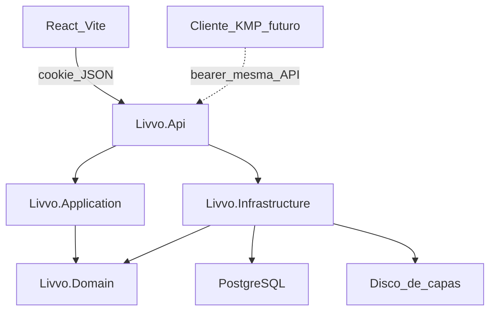
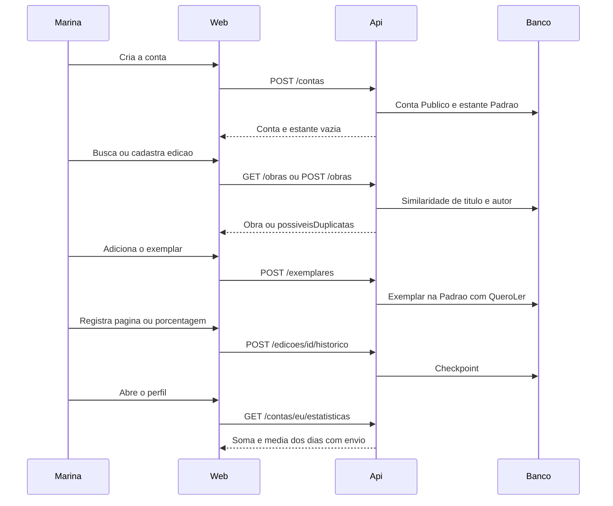
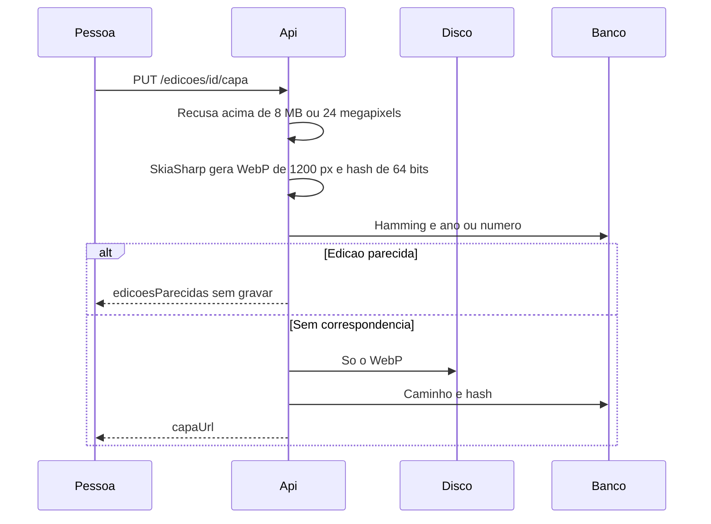

# Arquitetura — Livvo V0

**Data:** 2026-10-17
**Status:** Decidida
**PRD:** [PRD.md](PRD.md)
**Stack:** [stack.md](stack.md)
**Domínio:** [domain.md](domain.md)

A V0 é um monólito modular. A API HTTP JSON é o contrato estável. O navegador entra por cookie. O app em Kotlin Multiplatform, quando existir, entra por bearer na mesma API e no mesmo usuário, sem reescrever conta, obra ou histórico.

Esta etapa não desenha design system, interface nem logo. Também não quebra tasks nem implementa o produto.

## Harnessability

| Dimensão | Avaliação |
| --- | --- |
| Tipagem | C# com nullable e TypeScript estrito. O contrato OpenAPI gera os tipos do React. |
| Módulos | Quatro projetos .NET com dependência numa direção só. Teste de arquitetura quebra o build se a direção furar. |
| Framework | ASP.NET Core, EF Core e React Router absorvem hospedagem, persistência e rota. A regra de média, visibilidade e duplicata fica no domínio, não no framework. |
| Testabilidade | Casos de uso dependem de portas. A API sobe em `WebApplicationFactory` com PostgreSQL. |
| Observabilidade | Log estruturado e endpoint de saúde. Sem APM pago. |

## Horizonte e fatia

| Horizonte | Contratos | O que a fatia implementa |
| --- | --- | --- |
| Alvo | API HTTP JSON. Cookie no navegador. Bearer para o cliente KMP, no mesmo Identity. | A API e o cliente React. |
| V0 | Os caminhos deste documento. | Cookie. O endpoint de token não existe ainda. Não há projeto Kotlin. |

A implementação não inventa o bearer. A porta fica registrada para a conta não ser reescrita quando o app entrar (RNF-02, D-02).

## Camadas

```text
Domain ← Application ← Api
Domain ← Application ← Infrastructure
```

| Camada | Responsabilidade | Pode importar | Não pode importar | Como a violação aparece |
| --- | --- | --- | --- | --- |
| `Livvo.Domain` | Obra, edição, exemplar, estante, status, tags, visibilidade, histórico e a regra da média | Nada de outro projeto Livvo | EF Core, ASP.NET Core, arquivo, HTTP | NetArchTest no CI, com a camada e o tipo proibido na mensagem |
| `Livvo.Application` | Casos de uso da jornada e portas (repositório, relógio, similaridade, arquivo de capa) | `Livvo.Domain` | EF Core, ASP.NET Core, React | NetArchTest no CI |
| `Livvo.Infrastructure` | EF Core, Identity, `pg_trgm`, SkiaSharp, disco das capas, backup operacional | `Livvo.Application`, `Livvo.Domain` | `Livvo.Api` | NetArchTest no CI |
| `Livvo.Api` | Rotas, cookie, autorização no servidor | `Livvo.Application`, `Livvo.Domain`, `Livvo.Infrastructure` | Regra de média ou duplicata reimplementada na rota | Revisão e testes de aplicação |
| `web/` | React | HTTP JSON e o OpenAPI gerado | Projetos .NET | O cliente não referencia código de servidor |

Esconder dado na tela não cumpre a RNF-04. Perfil privado, item `SeguidoresAutorizados`, item `SomenteEu` e, na V1, anotação só saem do servidor para quem a regra autoriza. Texto de spoiler fica de fora desta regra: é da V1, e quem já pode ver a publicação pode receber o texto.

Projetos: `src/Livvo.Domain`, `src/Livvo.Application`, `src/Livvo.Infrastructure`, `src/Livvo.Api`, `web/`.

## Componentes



Nginx termina o TLS e encaminha para o Kestrel. `UseForwardedHeaders` roda antes de autenticação. O processo sobe pelo systemd.

Busca e cadastro usam só o que as pessoas gravaram. Não há cliente de Pagy, Skoob, Google Books, Amazon ou ISBN Database (R-01).

## Contratos

Nomes estáveis: `conta`, `obra`, `edicao`, `estante`, `exemplar`, `historico`. Autorização sempre no servidor. O documento OpenAPI gerado no build é o contrato executável. O React usa tipos gerados a partir dele. O cliente KMP futuro lê o mesmo documento.

`POST /contas`
Autenticação: anônimo.
Entrada: e-mail, nome, senha, `leitor`, `autor`, `perfil` opcional, `tema` opcional.
Saída: a conta. `perfil` omitido grava `Publico`. A estante `Padrão` nasce na mesma transação.
Erros: dados inválidos, e-mail já usado, leitor e autor ambos falsos.

`POST /sessao` e `DELETE /sessao`
Autenticação: anônimo para entrar, cookie para sair.
Entrada: e-mail e senha.
Saída: cookie de sessão, ou sessão encerrada.

`GET /contas/eu` e `PATCH /contas/eu`
Autenticação: a própria conta.
Entrada do PATCH: perfil, leitor, autor, tema, ou encerramento da conta.
Saída: a conta. `PATCH` troca `Publico` e `Privado` depois do cadastro.
Erros: não autenticado. Encerrar a conta remove o histórico dessa conta (RNF-06). Anotação privada entra nessa exclusão quando a V1 existir.

`GET /estantes` e `POST /estantes`
Autenticação: a própria conta.
Entrada: nome e visibilidade opcional.
Saída: a estante. Sem visibilidade, nasce `Publico` se o perfil for público e `SeguidoresAutorizados` se o perfil for privado.

`GET /obras?q=`
Autenticação: conta autenticada.
Saída: obras do catálogo compartilhado, por título e autor.

`GET /obras/{id}`
Autenticação: conta autenticada.
Saída: a obra e as edições, com `capaUrl` quando houver arquivo.

`POST /obras` e `POST /obras/{id}/edicoes`
Autenticação: conta autenticada.
Entrada da obra: título, autores, `tipo` opcional. Omissão de `tipo` grava `Livro`.
Entrada da edição: `ano` opcional, `numeroEdicao` opcional, quantidade de páginas opcional.
Saída: a obra ou a edição. Pode trazer `possiveisDuplicatas` (obra parecida por título e autor) ou `edicoesParecidas` (edição já cadastrada, a obra dela e os sinais `capa`, `ano`, `numeroEdicao`). A gravação da obra nova ou da edição nova só acontece quando a pessoa confirma que é outra, ou quando ela escolhe a existente.
Erros: confirmação ausente diante de correspondência.

`PUT /edicoes/{id}/capa`
Autenticação: conta autenticada. A capa é dado do catálogo compartilhado.
Entrada: `multipart/form-data`, JPEG, PNG ou WebP.
Saída: `capaUrl`, ou `edicoesParecidas` antes de substituir a capa, se o hash casar com outra edição.
Erros: arquivo acima de 8 MB, formato fora da lista, imagem acima de 24 megapixels.

`POST /exemplares`
Autenticação: a própria conta.
Entrada: edição existente, estante existente ou nome de estante nova, status opcional, tags opcionais, visibilidade opcional.
Saída: o exemplar na `Padrão` se nenhuma estante for escolhida. Status omitido grava `QueroLer`. Sem visibilidade, vale a regra da estante. `SomenteEu` só entra se o pedido pedir.
Erros: a conta já tem exemplar dessa edição.

`PATCH /exemplares/{id}`
Autenticação: a dona do exemplar.
Entrada: status, tags, estante ou visibilidade. Cada campo altera só o que veio. Trocar um não apaga os outros.

`PATCH /estantes/{id}`
Autenticação: a dona da estante.
Entrada: visibilidade.
Efeito: todos os exemplares da estante passam para essa visibilidade. As estatísticas não mudam.

`POST /edicoes/{id}/historico`
Autenticação: a conta que tem o exemplar dessa edição.
Entrada: página ou porcentagem, horário de início opcional.
Saída: o checkpoint. Os dois modos gravam. O horário pode vir vazio.
Erros: página e porcentagem juntos, ou nenhum dos dois.

`GET /contas/eu/estatisticas?periodo=mes|ano`
Autenticação: a própria conta.
Saída: soma de páginas do período e média igual a essa soma dividida pela quantidade de dias com envio. Dia sem envio fica fora.

Quem não é a dona não recebe estante, exemplar nem histórico de perfil `Privado`. Também não recebe item `SeguidoresAutorizados` nem `SomenteEu`. Na V0 os dois últimos são só da própria conta, porque ainda não há seguidor autorizado.

## Fluxos





## Decisões

### PostgreSQL no dedicado

Contexto: o servidor já está pago e o único custo novo é o domínio. MariaDB é o padrão da hospedagem compartilhada. O dedicado instala os dois.
Alternativas: MariaDB no mesmo servidor.
Decisão: PostgreSQL com `pg_trgm` e Npgsql.
Consequências: a operação instala e faz backup do PostgreSQL. A comparação de título e autor cabe no teto de 1 s.
RF/RNF: RNF-01, RNF-02, RNF-09, RF-06.

### Monólito modular e uma API

Contexto: poucos usuários no início, e a V1 não pode trocar a base nem reescrever conta, livro e histórico.
Alternativas: serviços separados por fatia, ou um backend só para o app futuro.
Decisão: um processo ASP.NET Core. O KMP é cliente futuro da mesma API.
Consequências: o bearer não é implementado na V0. A conta do Identity já é a conta do app.
RF/RNF: RNF-02, D-02.

### Cookie na V0

Contexto: a V0 é o site na mesma origem. O app nativo ainda não existe.
Alternativas: JWT desde o primeiro dia.
Decisão: cookie do Identity. Bearer fica como porta, sem rota.
Consequências: o site não guarda token. Quando o app entrar, a emissão de bearer usa o mesmo usuário.
RF/RNF: RNF-04, D-02.

### Perfil nasce público

Contexto: o PRD pede perfil público ou privado. Obrigar a escolha no cadastro acrescenta um passo que a pessoa não precisa decidir para entrar.
Alternativas: cadastro bloqueado até a escolha, ou default privado.
Decisão: omissão grava `Publico`. O cadastro pode enviar `Privado`. `PATCH /contas/eu` troca depois. Não há valor vazio.
Consequências: quem não mexe na opção fica pública. Perfil privado, na V0, só a própria conta vê.
RF/RNF: RF-01, RNF-04.

### Item privado nasce para seguidores

Contexto: seguidores chegam na V1. `SomenteEu` é mais fechado do que “perfil privado”.
Alternativas: perfil privado gravar `SomenteEu` nos itens, e migrar na V1.
Decisão: perfil `Publico` gera item `Publico`. Perfil `Privado` gera item `SeguidoresAutorizados`. `SomenteEu` só quando o pedido traz esse valor. Trocar o perfil não reescreve itens. Trocar a visibilidade da estante reescreve os exemplares dela.
Consequências: na V0, `SeguidoresAutorizados` se comporta como só a dona, porque não há autorização. Na V1 o valor já está certo.
RF/RNF: RF-22, RF-14, RNF-02, RNF-04.

### Checkpoint com avanço positivo

Contexto: a pessoa marca onde está, por página ou porcentagem. A estatística pede a soma das páginas lidas, e dia sem envio fica fora.
Alternativas: cada envio ser um incremento informado pela pessoa.
Decisão: o histórico guarda a posição. A soma é o total dos avanços positivos entre checkpoints da mesma edição. Porcentagem usa a quantidade de páginas da edição. Sem quantidade, o dia conta e a soma de páginas daquele checkpoint é zero.
Consequências: voltar página não reduz o total do período. Edição sem quantidade de páginas não inventa página.
RF/RNF: RF-07, RF-08.

### Dois avisos de duplicata

Contexto: o PRD pede proximidade de título e autor, e a capa da edição também indica que a edição já existe. A fila de cinco aprovações é da V1 e não fecha com poucos usuários.
Alternativas: um aviso só, misturando obra e edição, ou comparar a imagem pixel a pixel.
Decisão: obra quando título e autor passam de 0,35 no `pg_trgm`, com índice GIN. Edição quando a distância de Hamming do hash de 64 bits é menor ou igual a 8 e o ano ou o número coincidem, ou quando ano e número coincidem mesmo sem capa. Sinal isolado não avisa. Nulo não é igual. Limiares em configuração. A comparação do hash roda no PostgreSQL. Na V0 a pessoa confirma outra obra, confirma outra edição, ou usa a existente.
Consequências: capa parecida com ano diferente pode passar. A mesma edição fotografada de outro jeito pode passar se ano e número também faltarem.
RF/RNF: RF-06, R-03, RNF-09.

### Capa reduzida no próprio servidor

Contexto: a V0 mostra a capa da edição. O servidor é um só e não há armazenamento pago.
Alternativas: guardar o original, ou só limitar o tamanho sem converter.
Decisão: recusar acima de 8 MB, formato fora de JPEG, PNG ou WebP, e acima de 24 megapixels. SkiaSharp grava WebP com lado maior de 1200 px e qualidade 80, mais o hash. O original não fica. O backup copia esse diretório junto com o banco.
Consequências: o disco guarda uma imagem previsível. A aparência na tela fica para a etapa de design.
RF/RNF: RNF-01, RNF-09, RNF-10.

### Backup fora do disco principal

Contexto: a V0 inteira está nessa máquina. A forma do backup ficou para a arquitetura (D-06). Nenhum serviço de infraestrutura pago novo entra agora (RNF-01).
Alternativas: serviço de objeto pago, ou cópia só no mesmo disco.
Decisão: `pg_dump` diário cifrado, mais o diretório das capas, para um destino fora do disco principal, restaurável. O caminho do destino é configuração de operação.
Consequências: sem esse destino, a V0 não cumpre o R-04.
RF/RNF: R-04, RNF-01, D-06.

### Tipo da obra nasce livro

Contexto: o filtro por tipo é da V1, mas a obra não pode nascer sem tipo nem ser reescrita depois.
Alternativas: tipo nulo até alguém informar.
Decisão: `Livro`, `Quadrinho` ou `Revista`, default `Livro`, coluna não nula. Omissão grava `Livro`.
Consequências: obra cadastrada sem o campo é livro de verdade, não “desconhecido”.
RF/RNF: RF-10, RNF-02.

## Riscos

| Risco | Severidade | Mitigação |
| --- | --- | --- |
| Catálogo vazio no lançamento. A jornada depende de achar ou cadastrar uma edição. | Alto | O cadastro de obra e edição faz parte da V0, sem base importada. |
| Um servidor só. A máquina fora do ar derruba a RNF-09 e a RNF-10. | Alto | Backup diário do banco e das capas fora do disco. |
| Limiar 0,35 ou Hamming 8 junta registros diferentes, ou deixa duplicata passar. | Médio | A pessoa confirma outra obra ou outra edição, ou escolhe a existente. Os números ficam em configuração. |
| Destino de backup ainda não escolhido pela operação. | Alto | A V0 não se considera no ar, para o R-04, enquanto o destino não existir. |
| Nome Livvo e domínio adiados (D-01). | Médio | A arquitetura não escolhe domínio nem logo. |
| App nativo e progresso de outros leitores. | Baixo | Ficam fora da fatia. A API já é o contrato. |

## Sensores

Guias, antes de agir:

- Nullable e analyzers no .NET.
- TypeScript estrito, ESLint e `jsx-a11y` no React.
- NetArchTest com mensagem de remediação por camada.

Sensores no CI:

- Testes de aplicação da média, da cascata de visibilidade e dos dois avisos de duplicata, com PostgreSQL. Criar conta sem visibilidade grava `Publico`. Obra sem tipo grava `Livro`. Estante e exemplar criados com perfil privado gravam `SeguidoresAutorizados`. `SomenteEu` só aparece quando o pedido traz esse valor. Arquivo de capa acima de 8 MB ou de 24 megapixels é recusado. Imagem larga fica gravada com lado maior de 1200 px. Capa parecida com o mesmo ano avisa. Ano e número iguais avisam mesmo sem capa. Capa sozinha não avisa.
- Contrato: o build grava o OpenAPI. `WebApplicationFactory` percorre as rotas da V0 e confere status, erro e corpo, inclusive anônimo, outra conta e perfil privado. O CI falha se os tipos TypeScript do React divergirem do documento.
- Componentes: Vitest em modo browser, um Chromium, por papel acessível. Estante vazia, status e tags independentes, aviso de duplicata, histórico por página ou porcentagem com horário opcional, e tema que permanece.
- QA: Playwright no fluxo da Marina, projetos de computador e de celular, caminho de teclado em entrar, estante e histórico. `@axe-core/playwright` varre essas telas.
- `dotnet list package --vulnerable` e `npm audit`.

Fora do caminho crítico do commit:

- Log estruturado e endpoint de saúde.
- Teste de mutação semanal, depois que a suíte da V0 estiver estável.

## Fora desta arquitetura

Código, migração, workflow de CI, breakdown em tasks, cliente KMP, design system, desenho de interface e logo. O design vem depois deste documento e antes das tasks.
